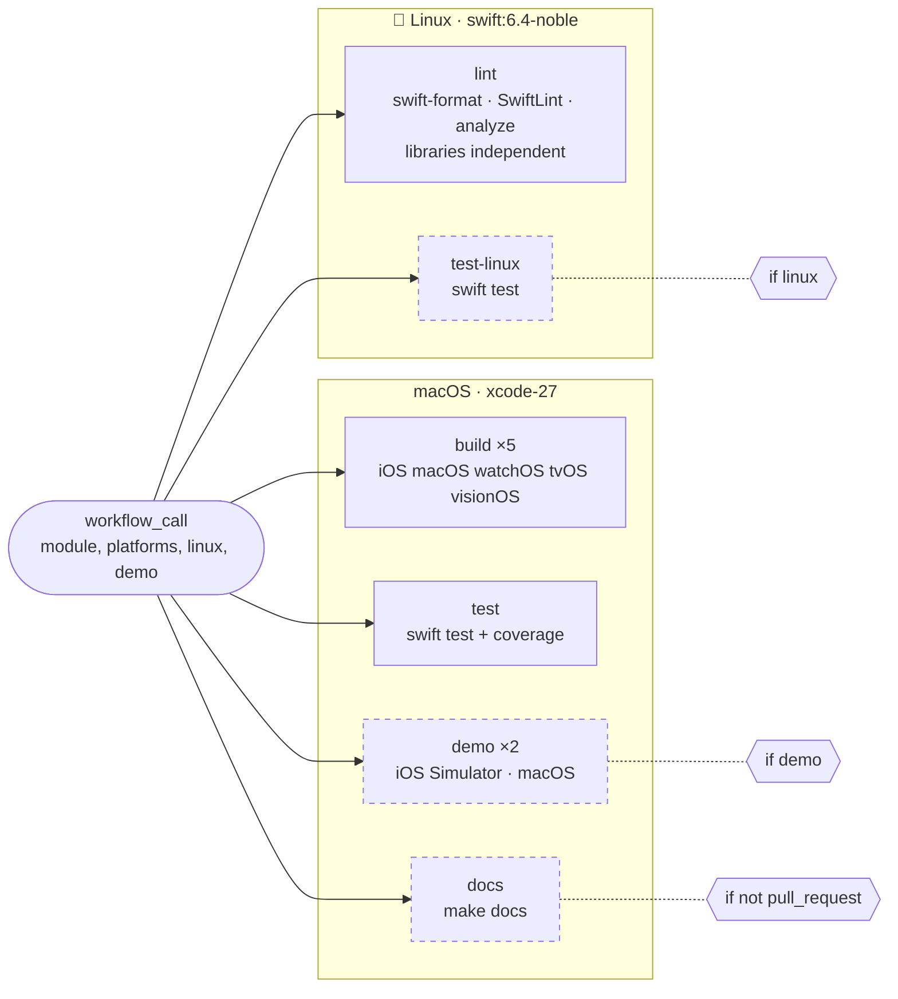
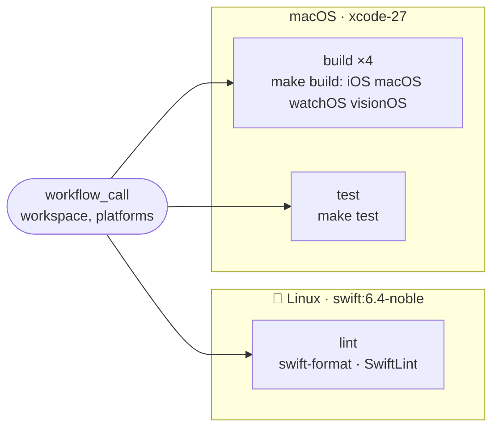
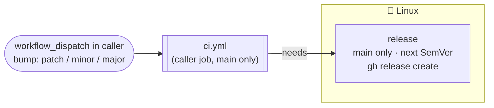
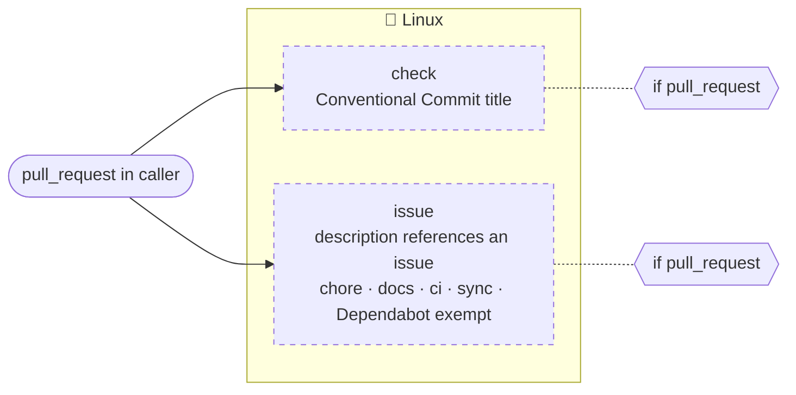

# Reusable workflows

Each diagram shows one workflow: its jobs, where they run, and how they depend on each other.
Jobs inside a workflow have no `needs:`, so they all start in parallel.

**Key:** 🐧 `ubuntu-latest` (in the `swift:6.4-noble` container where noted) ·  `inputs.runner`
(default `xcode-27`) · dashed border = conditional job · `×N` = matrix.

## `ci.yml`: library CI

## `ci-monorepo.yml`: monorepo CI

## `release.yml`: release

The caller runs `ci.yml` first, then this workflow, so a release only happens after CI passes.

## `pr-title.yml`: PR title and linked issue

