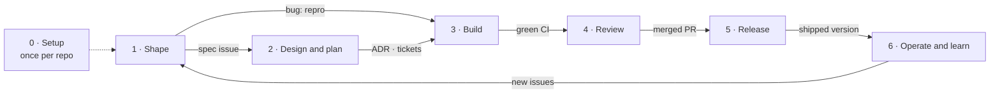

# ios-platform

Shared decisions, standards, CI and templates for a set of Swift libraries and the private apps
monorepo built on them. Every other repository follows what is defined here; none of them holds
its own copy of CI logic or shared configuration.

## Repositories

Listed in [`platform/registry/repos.yml`](platform/registry/repos.yml).

| Repository | Visibility | What |
| --- | --- | --- |
| `gpx-swift` | public | Read and write GPX files (the reference library) |
| `fit-swift` | public | Parse FIT files |
| `map-swift` | public | Render points on a map |
| `gps-swift` | public | Track location |
| `audio-swift` | public | Spoken cues, file playback and voice notes |
| `ultra-tools` | private | Monorepo of the apps released on the App Store |
| `ios-platform` | — | This repo |

## Layout

| Folder | Content |
| --- | --- |
| [`decisions/`](decisions/) | Architecture Decision Records (MADR): why things are the way they are |
| [`standards/`](standards/) | The rules that apply now, each with an ID (`CI-2`, `TEST-3`) to cite in reviews |
| [`.github/workflows/`](.github/workflows/) | Reusable workflows: `ci.yml` and `release.yml` for libraries, `ci-monorepo.yml` for the monorepo, `pr-title.yml` for every repo |
| [`.github/actions/select-xcode/`](.github/actions/select-xcode/) | Selects the Xcode pinned in the caller's `.xcode-version` |
| [`platform/templates/`](platform/templates/) | Scaffolds for new repos and the files synced into existing ones |
| [`platform/scripts/`](platform/scripts/) | `create-library.sh`, `create-monorepo.sh`, `sync.sh` |

## How work flows

Work moves through six phases, each ending in an artifact the next one uses. Specs and tickets are
GitHub issues; a trigger starts at the first phase it needs (a bug skips Design and plan, a crash
spike starts at Operate and learn). Rules and the phase table are in
[`standards/development-flow.md`](standards/development-flow.md).



## Common tasks

**Create a library.** See [`platform/templates/README.md`](platform/templates/README.md):

```
platform/scripts/create-library.sh gpx-swift GPXSwift "One sentence about the library"
```

**Change a shared file** (lint config, Makefile, agent instructions, skills). Edit it in
`platform/templates/sync/`, then open a sync PR in every active library:

```
platform/scripts/sync.sh --dry-run     # show what would change
platform/scripts/sync.sh               # one PR per repo
```

**Change CI.** Edit the reusable workflows here, and update the matching diagram in
[`.github/workflows/README.md`](.github/workflows/README.md). Callers pin `@v1`, so after merging a
compatible change, move the tag; a breaking change to the inputs gets `v2`
(see [`standards/ci.md`](standards/ci.md)):

```
git tag -f v1 && git push -f origin v1
```

**Record a decision.** Copy [`decisions/adr-template.md`](decisions/adr-template.md) to the next
number. Accepted ADRs are not edited; a new ADR supersedes them
(see [`decisions/README.md`](decisions/README.md)).

## Requirements

Xcode 27 (the version in `platform/templates/sync/.xcode-version`), SwiftLint, and `gh`
(authenticated) for the scripts that talk to GitHub.

## Licence

MIT, see [`LICENSE.txt`](LICENSE.txt).
