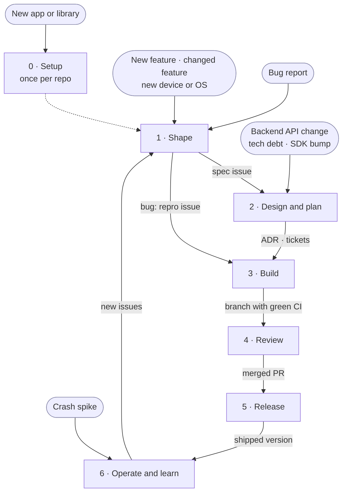

# Development Flow Standard

## Purpose

Every piece of work moves through the same phases, and each phase hands the next one a concrete
artifact, so no step is skipped and nothing produced along the way is throwaway.

## Scope

All work in every repository: libraries, `ultra-tools` and this repo. Phase 6 applies to the apps
only.

## The flow

Six phases and a one-time setup. A trigger starts work at the first phase it needs. Each arrow
names the artifact handed to the next phase.

Specs and tickets live in GitHub issues. A spec is one issue; its tickets are sub-issues with
blocking links. The PR closes the ticket (`Closes #N`).

| Phase | In | Out (gate) | Skills |
| --- | --- | --- | --- |
| **0 · Setup** (once) | Registry entry, template | Repo from template, `AGENTS.md`, `GLOSSARY.md`, issue tracker set up for the agent skills, green CI | `create-library.sh`, `setup-matt-pocock-skills`, `writing-for-agents` |
| **1 · Shape** | Idea, issue, bug report or crash cluster | Spec issue: problem, acceptance criteria, platforms and minimum OS. For a bug: a repro issue (steps or a failing test) | `grill-with-docs`, `research`, `domain-modeling`, `to-spec`, `triage` |
| **2 · Design and plan** | Spec issue | ADR when a decision is made, API contract (OpenAPI) when a backend changes, ticket sub-issues in order | `codebase-design`, `prototype`, `to-tickets`, `wayfinder`, `pfw-*` |
| **3 · Build** | One ticket | Code, passing tests, atomic commits, green CI on every platform | `tdd`, `implement`, `diagnosing-bugs`, `pfw-*` |
| **4 · Review** | Branch with green CI | PR that closes the ticket, with evidence; review findings resolved | `code-review`, `pr` |
| **5 · Release** | Merged PRs | Libraries: tag and GitHub Release. Apps: TestFlight build, reviewed privacy manifest, release notes | `create-release`, `wizard` |
| **6 · Operate and learn** (apps) | Shipped version | Crash and metrics review, retro, new issues for Shape | `triage`, `retro`, `improve-codebase-architecture` |

Not every change needs every phase. A bug skips Design and plan. A `chore`, `docs`, `ci` or sync
PR may start at Build with no issue.

## Rules

Rules use RFC 2119 levels: MUST (required), SHOULD (expected unless there is a good reason), MAY (optional).

| ID | Level | Rule |
| --- | --- | --- |
| FLOW-1 | MUST | Feature and change work starts from a spec issue with acceptance criteria and the target platforms and minimum OS |
| FLOW-2 | MUST | A bug fix starts from an issue with a repro and includes a test that fails without the fix |
| FLOW-3 | SHOULD | Work larger than one PR is split into ticket sub-issues of the spec issue, with blocking links |
| FLOW-4 | MUST | A change to architecture, a standard or a backend contract has an ADR (at least `proposed`) before Build starts |
| FLOW-5 | MUST | Every PR closes or references its issue, except `chore`, `docs`, `ci`, sync and Dependabot PRs |
| FLOW-6 | MUST | A PR that changes UI includes before and after screenshots |
| FLOW-7 | MUST | An app release goes through TestFlight first, with its privacy manifest reviewed for the release |
| FLOW-8 | SHOULD | After an app release, crashes and metrics are reviewed and findings filed as issues |

## Enforcement

| Rule | Check | Where |
| --- | --- | --- |
| FLOW-1 | Review (`to-spec` writes the template) | spec issue |
| FLOW-2 | Review | PR |
| FLOW-3 | Review (`to-tickets` creates the sub-issues) | spec issue |
| FLOW-4 | Review | PR |
| FLOW-5 | Review; an automated PR check is planned | PR |
| FLOW-6 | Review | PR |
| FLOW-7 | Review; an automated check is planned | `ultra-tools` release |
| FLOW-8 | Review | `ultra-tools` issues |

## Exceptions

A PR that breaks a rule says which rule and why in its description. A repo that permanently
works differently records it in its `AGENTS.md` (as `ultra-tools` does for other standards).

## Rationale

* ADR-0015: Use a six-phase development flow with GitHub issues as the spec

## Last reviewed

2026-11-22
